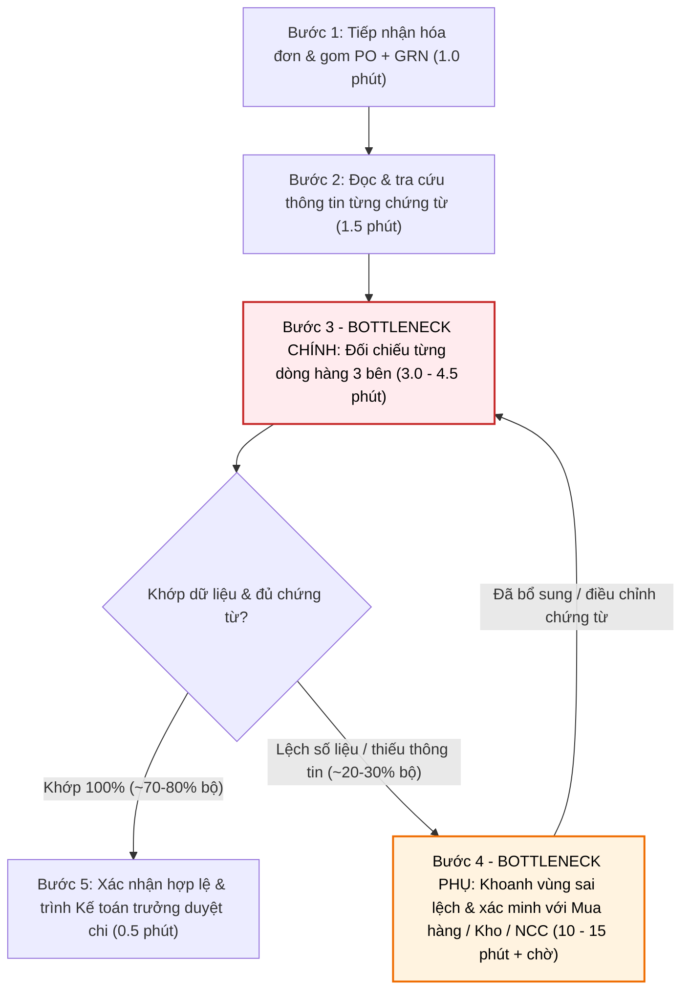
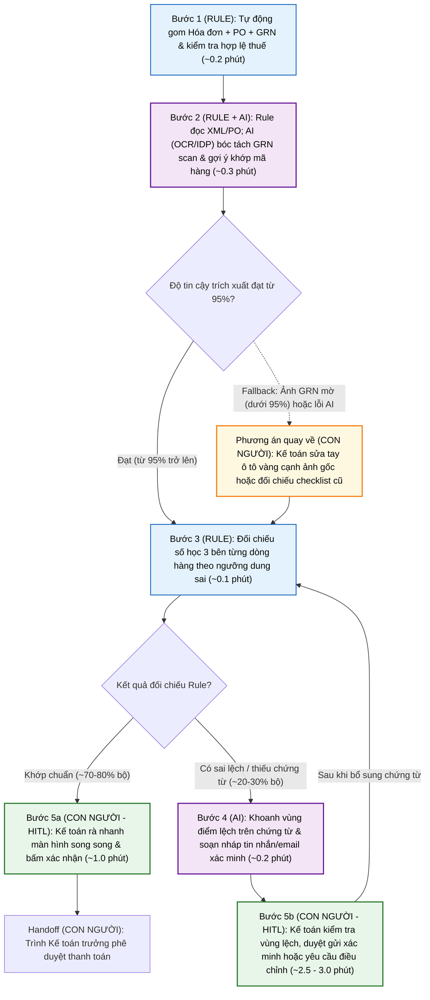

# Báo cáo nhóm — Day 02 Discovery & Problem Framing

> Bản chung của nhóm, viết trên repo do nhóm trưởng fork. Không copy file này sang repo cá nhân.
> Template chi tiết và prompt mẫu: [docs/01-worksheet.md](../../docs/01-worksheet.md). Bài mẫu: [docs/02-deliverable-example.md](../../docs/02-deliverable-example.md).

## 1. Thông tin nhóm

- Tên nhóm:D3
- Thành viên: xem `TEAM.md`
- Candidate problem được chọn (1 câu): Khi nhận được hóa đơn từ nhà cung cấp, nhân viên kế toán công nợ muốn đối chiếu thông tin với đơn đặt hàng (PO) và biên bản giao nhận, để đảm bảo tính chính xác trước khi thanh toán. Đối chiếu thông tin hóa đơn từ nhà cung cấp với đơn đặt hàng (PO) và biên bản giao nhận hàng (Kế toán công nợ - Candidate #8).
- Quyết định cuối: Not Yet

---

## 2. Hội tụ nhóm (CP3)

### 2.1. Pitch

| # | Người đưa ra | Candidate (Job Story ngắn) | Actor | Bottleneck | Câu hỏi phản biện nhận được (ai hỏi) |
|---:|---|---|---|---|---|
| 1 |Đào Ngọc Hân |Khi xe Xanh SM tiến vào bán kính đón khách nhưng bị khuất tầm nhìn (sảnh tòa nhà, phân khu đô thị, ngõ đông), tài xế và khách đặt xe muốn báo hiệu xe sắp cập điểm và nhận diện chính xác vị trí đứng thực tế của nhau mà không phải vừa lái xe vừa bấm gọi điện mô tả qua lại, để đón khớp ngay lần đầu và lái xe an toàn |Tài xế XanhSM và Khách hàng |**Bước 2 (1.0 phút)** và **Bước 3 (1.5–2.0 phút)** — tổng cộng **2.5–3.5 phút/cuốc**: tài xế vừa lái xe vừa phải bấm gọi thủ công (gây phân tâm), sau đó hai bên mất thời gian mô tả điểm mốc bằng lời do bất đồng góc nhìn trên đường| Quyến hỏi: về luật pháp, không cho phép sử dụng tai nghe khi lái xe? |
| 2 |Đào Ngọc Hân |Khi mở lại nhóm chat Zalo/Discord học tập hoặc dự án sau vài giờ bận, tôi muốn nắm ngay các quyết định đã chốt, deadline và phần việc giao cho mình giữa hàng trăm tin nhắn rời rạc, để không bỏ sót đầu việc chung hoặc phải hỏi lại cả nhóm |Học viên / thành viên nhóm dự án (tham gia đồng thời 3–4 nhóm chat hoạt động liên tục) |**Bước 3 (10 phút/lần/nhóm):** Phải đọc lướt và ghép ngữ cảnh từ luồng hội thoại phi cấu trúc vì câu chốt thường viết tắt (*"Chốt phương án 2 như bạn A nói ở trên nhé"*), buộc phải lội ngược tìm tin nhắn gốc |Công hỏi: Rủi ro khi AI tóm tắt nhầm thông tin thời gian cuộc họp |
| 3 |Đào Ngọc Hân |Khi chi tiêu sinh hoạt hằng ngày qua nhiều tài khoản ngân hàng, quét mã QR và ví điện tử, tôi muốn gom các giao dịch lẻ về đúng danh mục chi tiêu vào cuối tuần, để biết mình đang vượt hạn mức ở nhóm nào trước khi hết tháng |Sinh viên / người đi làm trẻ thanh toán không tiền mặt qua 1–2 tài khoản ngân hàng chính và 1 ví điện tử |**Bước 2 (12 phút)** và **Bước 3 (8 phút)** — tổng **20 phút/tuần**: phải nhớ lại ngữ cảnh giao dịch chuyển khoản QR chỉ hiện tên chủ tài khoản cá nhân và nhập tay từng khoản lẻ | Nguyên hỏi: Vấn đề về cho phép truy cập thông tin của ngân hàng |
| 4 |Lê Thành Nguyên |Khi team đổi phiên bản prompt, tôi muốn biết bản mới tốt hơn hay tệ hơn bản cũ, để báo mentor có nên đưa lên bản chạy thật không |AI intern (người chấm); mentor dùng kết quả	 |Bước 3: đọc, đối chiếu nguồn, chấm 100 cặp câu trả lời, khoảng 90 phút/người/lần (cả quy trình khoảng 150 phút, 2 lần/tuần) | Quyến hỏi: Nếu dùng LLM để kiểm tra thông tin kết quả của output của AI local của doanh nghiệp thì có thể rủi ro bảo mật |
| 5 |Lê Thành Nguyên |Khi mentor hỏi "cấu hình nào cho kết quả tốt nhất tuần trước", tôi muốn tìm lại đúng tham số và kết quả của từng lần chạy, để trả lời ngay mà không phải chạy lại |Tôi (người chạy thí nghiệm). Mentor là người hỏi và dùng kết quả |Bước 3, mở từng log để đọc tham số và metric rồi chép tay: khoảng 15 phút/lần (thêm 30–60 phút máy chạy nếu rơi vào bước 4) | Công hỏi: Chưa rõ về hướng ứng dụng AI vào xử lý bài toán |
| 6 |Lê Thành Nguyên |Khi một intern mới vào nhóm, bạn ấy muốn tự cài được môi trường và chạy được project mẫu ngay trong ngày đầu, để không phải chờ người khác hỗ trợ  |Intern mới (người gặp khó). Tôi và mentor là người bị hỏi lại  |Bước 3–4, cài thư viện và gỡ lỗi xung đột phiên bản: 60–120 phút mỗi người, cộng 10–15 phút của người trả lời cho mỗi câu hỏi  |Hân hỏi: Có thể áp dụng chatbot vào để tăng hiệu quả làm việc được không |
| 7 |Nguyễn Thành Công |Khi nhận được nhiều CV cho một vị trí tuyển dụng, tôi muốn đánh giá mức độ phù hợp của từng ứng viên với yêu cầu công việc, để rút ngắn thời gian sàng lọc và không bỏ sót ứng viên tiềm năng. |Nhân viên tuyển dụng |Bước 2–3 – Đọc CV và đối chiếu với yêu cầu tuyển dụng, khoảng 3–5 phút/CV (ước tính).  |Hân hỏi : Trong thời đại ngày nay, ứng viên dùng AI để viết CV thì có hỗ trợ sàng lọc được hay không |
| 8 |Nguyễn Thành Công |Khi nhận được hóa đơn từ nhà cung cấp, tôi muốn đối chiếu thông tin với đơn đặt hàng và biên bản giao nhận, để đảm bảo tính chính xác trước khi thanh toán. |Nhân viên kế toán công nợ |Bước 4 – Đối chiếu thông tin giữa 3 loại chứng từ, khoảng 3–7 phút/hóa đơn (ước tính).  |Quyến hỏi: Rủi ro về kinh tế khi thông tin và đối chiếu của AI sai lệch mà không được confirm lại |
| 9 |Nguyễn Thành Công |Khi tiếp nhận yêu cầu đổi trả, hoàn tiền hoặc tra cứu đơn hàng, tôi muốn xác định chính xác nội dung và mức độ ưu tiên của từng yêu cầu, để chuyển đến đúng bộ phận và xử lý kịp thời. |Nhân viên chăm sóc khách hàng |Bước 2–3 – Hiểu nội dung yêu cầu và tra cứu thông tin liên quan, ước tính 3–6 phút/ticket. | |
| 10 |Đồng Văn Quyến |Khi khách hàng gửi cùng một loại câu hỏi về đơn hàng/dịch vụ qua nhiều kênh, họ muốn được trả lời nhanh, chính xác và nhất quán, để không phải hỏi lại hoặc chờ lâu |Người phụ trách ghi biên bản, team member |Bước 3–4: viết lại và tách việc mất khoảng 20 phút/buổi, dễ ghi nhầm người phụ trách hoặc thiếu hạn chót |  |
| 11 |Đồng Văn Quyến |Khi nhận bàn giao ca trực, cần nắm đầy đủ diễn biến sức khỏe, thuốc đã dùng, chỉ định đang thực hiện, kết quả đang chờ và việc còn tồn của từng bệnh nhân, để chăm sóc tiếp chính xác và không bỏ sót việc của ca trước |điều dưỡng, bác sĩ |Bước 3: đọc và đối chiếu hồ sơ, y lệnh, kết quả đang chờ từ nhiều nguồn, khoảng 15–20 phút; hay sót kết quả đang chờ và thay đổi thuốc | Công hỏi: Việc thao tác với thông tin của bệnh nhân và hệ thống quản lý bệnh viện có khả thi không |
| 12 |Đồng Văn Quyến |Khi vừa họp team xong, tôi muốn có bản tóm tắt các vấn đề đã bàn, cách giải quyết, việc cần làm, người phụ trách và hạn chót, để không ai bỏ sót việc |Người phụ trách ghi biên bản, team member  |Bước 3–4: viết lại và tách việc mất khoảng 20 phút/buổi, dễ ghi nhầm người phụ trách hoặc thiếu hạn chót |Hân hỏi: Khả năng cạnh tranh thị trường với các hệ sinh thái lớn rất khó?|

### 2.2. Cluster

| Cluster | Các candidate | Pattern chung |
|---|---|---|
| **A — Tổng hợp & bàn giao từ luồng thông tin phân mảnh** | `#2` Lội tin nhắn nhóm chat Zalo/Discord bị trôi · `#12` Viết biên bản & tách việc sau họp team · `#11` Tổng hợp hồ sơ bàn giao ca trực y tế · `#3` Gom và phân loại giao dịch chi tiêu đa kênh | Thông tin quan trọng (quyết định, đầu việc, y lệnh, giao dịch) nằm rải rác hoặc phi cấu trúc qua nhiều luồng/ứng dụng; người làm phải đọc lại từ đầu để lọc nhiễu và tổng hợp tránh bỏ sót |
| **B — Đối chiếu đa nguồn & chấm/sàng lọc theo tiêu chí** | `#4` Đối chiếu nguồn & chấm 100 cặp output khi đổi prompt · `#5` Tra cứu tham số & metric từ nhiều file log thí nghiệm · `#7` Sàng lọc hàng trăm CV theo JD · `#8` Đối chiếu 3 bên (Hóa đơn – PO – Biên bản giao nhận) | Phải mở song song nhiều tài liệu/bản ghi để so khớp từng trường dữ liệu hoặc chấm điểm thủ công lặp đi lặp lại theo bộ tiêu chí chuẩn, tốn nhiều giờ công và dễ sót lỗi do mỏi mắt |
| **C — Tiếp nhận, phân luồng & giải đáp yêu cầu lặp lại** | `#9` Phân loại & xác định ưu tiên ticket đổi trả/hoàn tiền · `#10` Trả lời câu hỏi khách hàng trùng lặp đa kênh · `#6` Gỡ lỗi cài môi trường lặp lại cho intern mới ngày đầu | Người phụ trách (CSKH, mentor) liên tục bị ngắt quãng bởi các câu hỏi, ticket hoặc sự cố quen thuộc lặp đi lặp lại, mất thời gian phân loại thủ công và trả lời lại cùng một nội dung |
| **D — Phối hợp & định vị điểm đón thời gian thực ngoài hiện trường** | `#1` Tài xế Xanh SM và khách gọi điện báo xe đến & mô tả vị trí đón thực tế khi bị khuất tầm nhìn | Bất cân xứng thông tin vị trí thực tế giữa hai phía đang di chuyển ngoài đường (lệch ghim GPS / khuất tầm nhìn), buộc phải gọi điện mô tả điểm mốc bằng lời ngay lúc đang lái xe gây trễ chuyến và mất an toàn |

### 2.3. Opportunity Solution Tree rút gọn

Gốc là **1 outcome**. Nhánh là **opportunity** (nhu cầu, pain), không phải tính năng hay công cụ.

```text
OUTCOME: Giảm thời gian người làm việc phải tự tổng hợp, đối chiếu và xử lý lặp lại thông tin bằng tay,
         mà không tăng tỷ lệ bỏ sót việc hoặc đánh giá sai
├── Opportunity A (Cluster A): Thông tin quan trọng nằm rải rác, phi cấu trúc ở nhiều luồng nên phải đọc lại từ đầu mới lọc ra được, dễ bỏ sót
│   ├── #2  Câu chốt, deadline, việc được giao chìm giữa hàng trăm tin nhắn; lội ngược tìm tin gốc khoảng 10 phút/lần/nhóm
│   ├── #12 Sau họp phải viết lại biên bản và tách việc, khoảng 20 phút/buổi, dễ ghi nhầm người phụ trách hoặc thiếu hạn chót
│   ├── #11 Khi nhận ca phải đọc, đối chiếu hồ sơ, y lệnh, kết quả đang chờ từ nhiều nguồn, 15–20 phút, hay sót thay đổi thuốc
│   └── #3  Giao dịch QR chỉ hiện tên người nhận, phải nhớ lại ngữ cảnh và nhập tay từng khoản, khoảng 20 phút/tuần
├── Opportunity B (Cluster B): Phải mở song song nhiều tài liệu hoặc bản ghi để so khớp, chấm thủ công theo tiêu chí, tốn giờ công và dễ sót lỗi
│   ├── #4  Mỗi lần đổi prompt phải đối chiếu nguồn và chấm tay 100 cặp câu trả lời, khoảng 150 phút/lần, 2 lần/tuần
│   ├── #5  Mở từng file log để chép tay tham số và metric, khoảng 15 phút/lần; mất log thì phải chạy lại
│   ├── #7  Đọc từng CV để so với yêu cầu công việc, khoảng 3–5 phút/CV
│   └── #8  Đối chiếu 3 chứng từ (hóa đơn, đơn đặt hàng, biên bản giao nhận), khoảng 3–7 phút/hóa đơn
└── Opportunity C (Cluster C): Người phụ trách liên tục bị ngắt quãng bởi câu hỏi, ticket, sự cố quen thuộc, phải phân loại và trả lời lại cùng một nội dung
    ├── #9  Phải hiểu nội dung, xác định mức ưu tiên từng yêu cầu đổi trả/hoàn tiền để chuyển đúng bộ phận, 3–6 phút/ticket
    ├── #10 Khách hỏi cùng một loại câu hỏi qua nhiều kênh, phải trả lời tay từng lần và khó giữ câu trả lời nhất quán
    └── #6  Intern mới gặp cùng các lỗi cài môi trường, mỗi người mất 60–120 phút, người hướng dẫn bị hỏi lại 10–15 phút/câu
```

Không đưa vào cây:

- **Cluster D (#1, đón khách khuất tầm nhìn):** pain về phối hợp vị trí theo thời gian thực giữa hai bên đang di chuyển ngoài đường, không phải tổng hợp, đối chiếu hay xử lý thông tin lặp lại, nên không phục vụ outcome trên. Nhóm giữ lại như một hướng riêng nếu muốn đổi outcome.

Những ý đã gạch bỏ vì là solution đội lốt opportunity:

- ✗ "AI tóm tắt nhóm chat" (#2): đây là tính năng. Pain thật là câu chốt, deadline bị chìm giữa hàng trăm tin nhắn.
- ✗ "Kết nối, truy cập dữ liệu ngân hàng để tự phân loại chi tiêu" (#3): đây là giải pháp. Pain thật là giao dịch QR thiếu ngữ cảnh, phải nhớ và nhập tay.
- ✗ "Dùng LLM để chấm, kiểm tra output của mô hình" (#4): đây là cách làm. Pain thật là chấm tay lâu và hai người chấm lệch nhau.
- ✗ "Chatbot hỗ trợ intern hoặc trả lời khách" (#6, #10): đây là công cụ. Pain thật là trả lời lặp lại cùng một câu hỏi.
- ✗ "AI sàng lọc CV" (#7): đây là công cụ. Pain thật là đọc và đối chiếu từng CV với yêu cầu công việc.
- ✗ "AI đối chiếu chứng từ" (#8): đây là giải pháp. Pain thật là đối chiếu tay 3 loại chứng từ, dễ sót sai lệch.
- ✗ "Dùng tai nghe để gọi khi lái xe" (#1): đây là cách làm. Pain thật là phải liên lạc và mô tả vị trí bằng lời trong lúc đang lái.

### 2.4. Chấm điểm shortlist (1–5)

| Candidate | Actor rõ | Quy trình rõ | Pain có bằng chứng | Impact đo được | Vừa sức lab | So sánh được No AI/Rule/Workflow/Agent | Nhóm hiểu domain | Tổng |
|---|---:|---:|---:|---:|---:|---:|---:|---:|
| #1 Khớp điểm đón Xanh SM | 4 | 3 | 3 | 3 | 2 | 2 | 4 | 21 |
| #2 Tóm tắt chat Zalo/Discord | 4 | 4 | 4 | 3 | 5 | 4 | 4 | 28 |
| #3 Gom sao kê ngân hàng/ví | 4 | 4 | 3 | 3 | 3 | 3 | 4 | 24 |
| #4 Đánh giá cặp câu prompt AI | 4 | 4 | 4 | 4 | 4 | 4 | 3 | 27 |
| #5 Truy vết tham số thí nghiệm | 4 | 3 | 3 | 3 | 4 | 4 | 3 | 24 |
| #6 Hỗ trợ intern cài môi trường | 4 | 3 | 3 | 3 | 4 | 3 | 4 | 24 |
| #7 Sàng lọc CV ứng viên | 5 | 4 | 4 | 4 | 4 | 4 | 3 | 28 |
| #8 Đối chiếu hóa đơn - PO - Giao nhận (Chọn) | 5 | 5 | 4 | 5 | 5 | 5 | 4 | 33 |
| #9 Phân loại ticket đổi trả CSKH | 4 | 4 | 3 | 3 | 4 | 4 | 3 | 25 |
| #10 Trả lời câu hỏi trùng CSKH | 4 | 4 | 4 | 4 | 4 | 4 | 3 | 27 |
| #11 Bàn giao ca trực bệnh viện | 4 | 4 | 5 | 4 | 2 | 4 | 2 | 25 |
| #12 Biên bản & việc sau họp team | 5 | 4 | 4 | 4 | 5 | 4 | 4 | 30 |

**Candidate được chọn:**
Candidate #8: Đối chiếu thông tin hóa đơn từ nhà cung cấp với đơn đặt hàng (PO) và biên bản giao nhận hàng (Nguyễn Thành Công).

**Vì sao chọn:**
1. **Actor và quy trình cực kỳ chuẩn xác và rõ ràng (5/5):** Kế toán công nợ thực hiện 3-way matching theo bộ 3 chứng từ cố định (Hóa đơn - PO - Phiếu giao nhận).
2. **Impact đo lường được ngay bằng thời gian và tiền bạc (5/5):** Mỗi hóa đơn mất 3–7 phút đối chiếu thủ công; rủi ro trả thừa tiền hoặc chậm thanh toán phạt vi phạm hợp đồng có tác động tài chính trực tiếp và rõ ràng.
3. **Cực kỳ vừa sức trong khuôn khổ bài lab (5/5):** Dữ liệu dạng chứng từ, file PDF/ảnh scan/bảng tính hoàn toàn giả lập hoặc thu thập mẫu thực tế được mà không vi phạm bảo mật nhạy cảm.
4. **Thể hiện trọn vẹn sự so sánh 4 mức độ can thiệp AI (5/5):**
   - *No AI:* Bảng checklist và mẫu form cứng đối chiếu bằng mắt.
   - *Rule:* Viết script/macro đối chiếu trực tiếp các trường số liệu khi dữ liệu đã ở dạng bảng Excel/CSV.
   - *Workflow:* OCR trích xuất trường dữ liệu từ PDF/ảnh hóa đơn -> Rule so khớp số lượng/đơn giá -> AI tóm tắt giải trình điểm lệch -> Kế toán kiểm tra xác nhận duyệt chi.
   - *Agent:* Tự động quét email lấy hóa đơn, tự vào kho lấy phiếu giao hàng, tự quyết định chi tiền (Rủi ro rất cao về tài chính nếu thiếu người duyệt).

**Vì sao loại các candidate còn lại:**
- **#1 (Khớp điểm đón Xanh SM):** Thuộc bài toán GPS/thời gian thực/an toàn giao thông ngoài thực địa, không thể làm và test trong bài lab, khó can thiệp bằng mô hình ngôn ngữ thông thường.
- **#3 (Gom sao kê ví/ngân hàng) & #11 (Bàn giao ca trực bệnh viện):** Vướng rào cản rất lớn về chính sách bảo mật dữ liệu nhạy cảm (tài chính cá nhân, hồ sơ bệnh án). Nhóm thiếu domain sâu về lâm sàng và không có quyền truy cập hệ thống bệnh viện thật.
- **#5, #6:** Mang tính đặc thù cá nhân trong phòng lab/nội bộ team lập trình, quy trình phụ thuộc nhiều vào từng hệ thống máy, khó chuẩn hóa và impact không đủ lớn.
- **#2, #12 (Tóm tắt chat / họp team):** Mặc dù điểm số cao (28-30) và vừa sức, nhưng thị trường đã có quá nhiều giải pháp sẵn có (Zoom AI, Teams recap, Slack AI), khó tạo ra sự khác biệt và ranh giới đo lường "thế nào là tóm tắt tốt" mang tính chủ quan.
- **#7 (Sàng lọc CV) & #9, #10 (CSKH):** Sàng lọc CV tiềm ẩn thiên kiến đạo đức (bias) và khó có ground-truth chuẩn để đánh giá "độ phù hợp", trong khi đối chiếu hóa đơn có ground-truth 100% rõ ràng (khớp số tiền, khớp mã hàng, khớp số lượng).

**Xử lý bất đồng (nếu có):**
- Ban đầu một số thành viên đề xuất chọn **#12 (Biên bản họp)** vì bản thân ai cũng gặp hằng tuần, và **#11 (Bàn giao ca trực)** vì có impact an toàn con người rất lớn.
- Sau khi thảo luận phản biện, nhóm thống nhất:
  - #11 có rủi ro quá lớn về tính khả thi và bảo mật (Feasibility & Viability).
  - #12 khó xác định tiêu chí đúng/sai tuyệt đối (chất lượng biên bản phụ thuộc cảm tính).
  - #8 (Đối chiếu hóa đơn) đạt điểm đồng thuận cao nhất vì có tính khách quan (số liệu khớp hoặc không khớp), bài toán tài chính rõ ràng và làm rõ nét vai trò của người kiểm duyệt (Human-in-the-loop). Nhóm nhất trí chọn **#8** làm bài toán chung để đi tiếp vào CP4.

---

## 3. Kiểm chứng + research giải pháp đã có (CP4)

### 3.1. Assumption Map

| # | Giả định | Loại (Value / Usability / Feasibility / Viability) | Quan trọng (1–5) | Đã có bằng chứng (1–5) | Kiểm chứng trước? |
|---:|---|---|---:|---:|---|
| 1 |Sai lệch hoặc thiếu thông tin giữa các chứng từ thường xuyên xảy ra, gây chậm thanh toán và phát sinh xử lý lại. |Value |5 |1 |Có - Mức 3 |
| 2 |Các phần mềm kế toán hiện tại chưa đáp ứng đầy đủ nhu cầu đối chiếu chứng từ hoặc xử lý các trường hợp sai lệch phức tạp. |Viability |4 |1 |Có - Mức 4 |
| 3 |Hóa đơn, PO và GRN có thể được thu thập dưới dạng dữ liệu đủ rõ ràng để trích xuất các trường thông tin cần đối chiếu. |Feasibility |5 |2 |Có - Mức 5|
| 4 |Nhân viên kế toán có thể dễ dàng kiểm tra, xác nhận kết quả đối chiếu và chấp nhận đưa kết quả vào quy trình hiện tại. |Usability |4 |1 |Có - Mức 6 |


Giả định nhóm kiểm chứng trong buổi này:

### 3.2. Kiểm chứng

Nhóm sử dụng Desk Research và Competitor/Feature Audit để tìm hiểu quy trình đối chiếu chứng từ và khả năng xử lý của phần mềm kế toán hiện có.

Evidence snapshot – MISA AMIS:

| Trường | Nội dung |
|---|---|
| Nguồn |Tài liệu hướng dẫn chính thức MISA AMIS – Mua hàng theo đơn mua hàng. |
| Quy trình quan sát |Chọn PO → Lập chứng từ mua hàng → Tự động lấy thông tin từ PO → Kiểm tra và bổ sung thông tin còn thiếu. |
| Phát hiện |Phần mềm đã hỗ trợ liên kết dữ liệu giữa PO và chứng từ mua hàng. |
| Insight | Cần tập trung vào các trường hợp sai lệch hoặc thiếu thông tin mà quy trình hiện tại chưa xử lý tốt. |

Nguồn: MISA AMIS – Mua hàng theo đơn mua hàng (https://helpact.misa.vn/kb/muahang_theodonhang/)

Tổng hợp:

| Nguồn | Số người / số mẫu | Tín hiệu xác nhận | Tín hiệu phản bác |
|---|---:|---|---|
| Tài liệu MISA AMIS | 2 tài liệu | Có nhiều thông tin chứng từ cần kiểm tra và liên kết giữa PO, phiếu nhập, hóa đơn. | Phần mềm đã hỗ trợ tự động lấy dữ liệu và một số thao tác kiểm tra. |
| Phân tích quy trình | 1 quy trình | Có bước kiểm tra thông tin và bổ sung dữ liệu còn thiếu. | Chưa có bằng chứng bước này thực sự mất nhiều thời gian. |

**Nhóm đã sửa problem thế nào sau kiểm chứng:**

Nhóm đã sửa problem: Thu hẹp từ "Đối chiếu toàn bộ chứng từ kế toán" thành "Phát hiện sai lệch và thiếu thông tin giữa hóa đơn, PO và GRN". Nhóm tập trung vào các trường hợp ngoại lệ thay vì những thao tác phần mềm hiện tại đã hỗ trợ.

Giả định chưa có đủ bằng chứng: Tần suất sai lệch, thời gian kế toán xử lý mỗi bộ chứng từ và mức độ ảnh hưởng thực tế đến quy trình thanh toán.

### 3.3. Research giải pháp đã có

| Công cụ / case / pattern | Link | Giải bước nào trong quy trình? | Điểm mạnh | Khoảng trống / rủi ro | Bài học cho nhóm |
|---|---|---|---|---|---|
| **AWS Textract (AnalyzeExpense) + Serverless Matching** | [AWS Textract Expense](https://aws.amazon.com/textract/) · [Sample Architecture](https://github.com/aws-samples/amazon-textract-invoice-processor) | Bước 2 (Trích xuất) & Bước 3 (Đối chiếu số liệu) | Trích xuất trường chuyên sâu (Line items, Vendor, PO, Total) theo chuẩn OCR tài chính; có kiến trúc mẫu kết nối ERP/Database | Chi phí tính theo lượt gọi API; không tự giải quyết được các bất đồng ngữ cảnh phi cấu trúc (ví dụ: tên hàng viết tắt khác nhau) | Dùng OCR/IDP chuyên dụng để lấy số liệu có cấu trúc, nhưng phần đối chiếu cần rule chặt chẽ và chấp nhận ngưỡng dung sai (tolerance). |
| **MISA meInvoice (Xử lý hóa đơn đầu vào & AI MISA AVA)** | [MISA meInvoice](https://meinvoice.vn/) | Bước 1, Bước 2 & kiểm tra tính hợp lệ cơ quan thuế | Tự động đồng bộ với Tổng cục Thuế, kiểm tra hóa đơn hủy/thay thế, tự động hạch toán vào AMIS/ERP nội địa | Chủ yếu tập trung vào đối soát thuế và hạch toán kế toán, chưa tối ưu sâu khâu 3-way matching phức tạp với biên bản giao nhận kho lẻ | Nghiệp vụ thuế và tính hợp pháp của hóa đơn có thể giải quyết bằng hệ thống sẵn có; nhóm nên tập trung vào điểm nghẽn **đối chiếu số lượng/đơn giá thực tế với PO và kho**. |
| **Rossum.ai (IDP & Accounts Payable)** | [Rossum AP Solution](https://rossum.ai/solutions/accounts-payable/) | **Bước 2** (OCR/IDP), **Bước 3** (Line-item Matching) & **Bước 4** (Exception Handling) | Công nghệ trích xuất không phụ thuộc template (Rossum Aurora); so khớp từng dòng hàng (line-item) giữa Hóa đơn và PO; giao diện làm nổi bật điểm lệch. | Cần cấu hình ngưỡng dung sai (tolerance) phức tạp; rủi ro nhận diện sai nếu nhà cung cấp gộp nhiều mã hàng thành một dòng. | Tách bạch rõ 2 bước: Dùng AI đọc hiểu bố cục phi cấu trúc thành JSON, sau đó áp dụng **Rule kiểm tra số học và mã hàng**, không để AI tự quyết toán tiền. |


**Kết luận research:**
```text
Thị trường đã có rất nhiều giải pháp từ mức Enterprise (akaBot, SAP) đến Low-code/Open-source (n8n, AWS Textract).
Vì vậy, nhóm KHÔNG TỰ XÂY dựng công cụ trích xuất hay chatbot từ con số không.
Hướng giải pháp hợp lý nhất: 
Kiến trúc Workflow: OCR trích xuất -> Rule so khớp 3 bên (Hóa đơn vs PO vs Phiếu kho) -> AI phân tích lý do lệch (nếu có) -> Kế toán viên kiểm duyệt và bấm xác nhận chi.
```

---

## 4. Quy trình trước/sau (CP5)

### 4.1. Quy trình hiện tại

Sơ đồ quy trình hiện tại (*tổng thời gian thao tác: **6.0–7.5 phút/bộ** với luồng khớp chuẩn; **16–22 phút thao tác/bộ + thời gian chờ** khi phát sinh ngoại lệ; tần suất ước tính **30–100 bộ chứng từ/ngày***):



| Bước | Actor | Input | Output | Thời gian / tần suất | Ghi chú & Handoff |
|---:|---|---|---|---|---|
| 1 | Nhân viên kế toán công nợ *(nhận chứng từ từ NCC, Mua hàng, Kho)* | Hóa đơn điện tử (PDF/XML qua email hoặc meInvoice), mã tham chiếu đơn mua hàng | Bộ 3 chứng từ liên quan đặt cạnh nhau: Hóa đơn + Đơn đặt hàng (PO) + Biên bản giao nhận (GRN) | **1.0 phút/bộ** · 30–100 bộ/ngày | *Handoff đầu vào:* NCC gửi hóa đơn, Mua hàng cung cấp PO, Kho chuyển phiếu/ảnh GRN; dễ thiếu GRN khi giao hàng lẻ nhiều đợt |
| 2 | Nhân viên kế toán công nợ | Bộ 3 chứng từ ở nhiều định dạng khác nhau (PO trên phần mềm/Excel, Hóa đơn PDF/XML, GRN bản scan/ảnh chụp giấy có chữ ký tay) | Các trường thông tin cần kiểm tra đã mở sẵn trên màn hình (tên/MST NCC, danh mục hàng, số lượng thực nhận, đơn giá, VAT, tổng tiền) | **1.5 phút/bộ** · 30–100 bộ/ngày | Phần mềm kế toán (như MISA AMIS) hỗ trợ kéo dữ liệu từ PO sang chứng từ mua, nhưng GRN kho lẻ thường vẫn là ảnh chụp/phiếu giấy ghi tay số thực nhận |
| 3 | Nhân viên kế toán công nợ | Các trường dữ liệu dòng hàng (*line-items*) trên Hóa đơn, PO và GRN | Kết luận đối chiếu từng dòng: **Khớp hoàn toàn** hoặc **Danh sách trường bị lệch / thiếu** | **3.0 – 4.5 phút/bộ** · 30–100 bộ/ngày | **🔴 BOTTLENECK CHÍNH:** Phải dò bằng mắt qua 3 cửa sổ/tài liệu; tên hàng trên hóa đơn NCC thường viết khác mã/tên nội bộ trên PO, hoặc 1 PO tách làm nhiều lần giao hàng/nhiều hóa đơn |
| 4 | Nhân viên kế toán công nợ *(phối hợp Mua hàng, Thủ kho, NCC)* | Các điểm không khớp phát hiện ở Bước 3 (lệch số lượng giao thiếu/hàng lỗi, chênh đơn giá/chiết khấu, gộp mã hàng, thiếu chữ ký kho) | Yêu cầu giải trình gửi đúng bộ phận kèm bằng chứng; nhận lại biên bản xác nhận bổ sung hoặc hóa đơn điều chỉnh | **0 phút** *(nếu khớp)*; **10–15 phút thao tác/bộ + vài giờ chờ** *(với ~20–30% bộ ngoại lệ)* | **🟠 BOTTLENECK PHỤ (Exception Handling):** Phải chụp màn hình khoanh tay từng chỗ lệch gửi Zalo/Email hỏi lại Kho hoặc Mua hàng rồi quay lại kiểm tra từ Bước 3 |
| 5 | Nhân viên kế toán công nợ $\rightarrow$ Kế toán trưởng | Bộ chứng từ 3 bên đã khớp đầy đủ (hoặc đã có biên bản giải trình/hóa đơn điều chỉnh hợp lệ) | Bút toán công nợ được xác nhận trên phần mềm kế toán và hồ sơ đề nghị thanh toán | **0.5 phút/bộ** · 30–100 bộ/ngày | *Handoff đầu ra:* Chuyển Kế toán trưởng / Ban giám đốc phê duyệt chi tiền theo kỳ thanh toán |

**Bottleneck chính:**

- **Điểm nghẽn trực tiếp trên mọi bộ chứng từ — Bước 3 (*Đối chiếu từng dòng hàng 3 bên / Line-item Matching*, mất 3.0–4.5 phút/bộ):** Dù phần mềm kế toán hiện có đã liên kết được PO với chứng từ mua hàng ở luồng chuẩn, kế toán viên vẫn phải dò mắt thủ công từng dòng vì **bất đồng định dạng và cách gọi tên** (tên hàng hóa trên hóa đơn nhà cung cấp khác tên/mã vật tư nội bộ trên PO; đơn vị tính quy đổi thùng/hộp/cái; giao hàng từng phần làm số lượng trên GRN khác PO ban đầu). Với 30–100 bộ/ngày, riêng bước dò mắt này tiêu tốn **1,5 – 7,5 giờ công/ngày** và dễ sót lỗi do mỏi mắt.
- **Điểm nghẽn kéo dài thời gian xử lý — Bước 4 (*Xử lý ngoại lệ / Exception Handling*, mất thêm 10–15 phút thao tác/bộ bị lệch):** Khi phát hiện lệch số lượng hoặc đơn giá (ước tính ~20–30% số bộ chứng từ), kế toán phải tự trích lục, chụp ảnh khoanh vùng từng dòng sai để nhắn hỏi lại Kho/Mua hàng/NCC, làm đứt mạch công việc và gây chậm kỳ thanh toán.

### 4.2. Quy trình tương lai

Ghi rõ bước nào **Rule**, bước nào **AI**, bước nào **con người**, **boundary** ở đâu, **phương án quay về** khi AI sai.

Sơ đồ quy trình tương lai (*kỳ vọng tổng thời gian còn **~1.6 phút/bộ** với luồng khớp chuẩn — trong đó kế toán chỉ thao tác **~1.0 phút**; và **~3.3–3.8 phút/bộ** khi xử lý ngoại lệ*):



| Bước | Phân vai xử lý | Nội dung xử lý chi tiết | Input $\rightarrow$ Output | Thời gian kỳ vọng |
|---:|---|---|---|---|
| 1 | **`[RULE]`** *(Hệ thống sẵn có / meInvoice)* | Tự động kiểm tra tính hợp lệ hóa đơn với cơ quan thuế (MST, trạng thái hoạt động) và gom bộ 3 chứng từ (Hóa đơn – PO – GRN) theo mã tham chiếu đơn hàng | *In:* Email/file Hóa đơn, dữ liệu PO, ảnh/file GRN<br>*Out:* Bộ hồ sơ 3 bên đã liên kết (hoặc cờ cảnh báo thiếu chứng từ ngay đầu vào) | **~0.2 phút/bộ** *(tự động)* |
| 2 | **`[RULE + AI]`** *(OCR/IDP + LLM)* | **Rule** đọc trực tiếp trường có cấu trúc từ file XML hóa đơn và PO hệ thống; **AI (OCR/IDP)** trích xuất bảng hàng hóa từ ảnh chụp/scan GRN (kể cả ghi chú nhận hàng viết tay) sang JSON chuẩn và gợi ý ánh xạ tên hàng viết tắt của NCC với mã vật tư nội bộ trên PO | *In:* Bộ 3 chứng từ đa định dạng<br>*Out:* Bảng JSON chuẩn hóa từng dòng hàng kèm điểm tin cậy (*confidence score*) cho từng ô | **~0.3 phút/bộ** *(máy chạy)* |
| 3 | **`[RULE]`** *(Thuật toán kiểm tra số học)* | So khớp toán học 100% chính xác trên JSON: `SL Hóa đơn = SL thực nhận GRN ≤ SL đặt PO`, `Đơn giá Hóa đơn = Đơn giá PO` (trong ngưỡng dung sai làm tròn cho phép), kiểm tra thuế suất VAT và tổng cộng thành tiền | *In:* JSON chuẩn hóa của 3 chứng từ<br>*Out:* Trạng thái **Khớp 100%** hoặc **Danh sách dòng lệch / Ô có độ tin cậy OCR thấp (< 95%)** | **~0.1 phút/bộ** *(tự động)* |
| 4 | **`[AI]`** *(LLM hỗ trợ ngoại lệ)* | Chỉ kích hoạt với ~20–30% bộ bị Rule gắn cờ lệch/thiếu: AI khoanh vùng tọa độ dòng lệch trên ảnh chứng từ gốc, tóm tắt ngắn gọn lý do lệch (*"Dòng 2 giao thiếu 5 thùng theo GRN kho ngày 08/11"*) và soạn sẵn bản nháp tin nhắn/email xác minh cho đúng bộ phận | *In:* Kết quả báo lệch từ Bước 3 + ảnh chứng từ<br>*Out:* Tóm tắt ngoại lệ + Bản nháp yêu cầu giải trình gửi Kho / Mua hàng / NCC | **~0.2 phút/bộ lệch** *(máy chạy)* |
| 5 | **`[CON NGƯỜI — HITL]`** *(Kế toán công nợ $\rightarrow$ Kế toán trưởng)* | Kế toán rà soát trên giao diện đối chiếu song song (chứng từ gốc đặt cạnh bảng kết quả):<br>- *Nếu khớp chuẩn:* Kiểm nhanh các trường trọng yếu và bấm **Xác nhận hạch toán**.<br>- *Nếu có ngoại lệ / ô tô vàng:* Đối chiếu vùng khoanh đỏ trên ảnh gốc, sửa tay nếu OCR nhầm hoặc bấm duyệt gửi yêu cầu xác minh. Cuối cùng trình **Kế toán trưởng** duyệt chi | *In:* Giao diện đối chiếu song song + nháp giải trình (nếu có)<br>*Out:* Bút toán công nợ được xác nhận hợp lệ hoặc yêu cầu điều chỉnh đã gửi đi | **1.0 phút/bộ** *(luồng khớp)*<br>**2.5–3.0 phút/bộ** *(luồng ngoại lệ)* |

**Ranh giới kiểm soát (`Boundary`) & Điểm kiểm duyệt con người (`HITL`):**

- **Những việc AI tuyệt đối KHÔNG được làm:**
  1. **Không tự tính toán số học hoặc tự sửa/bịa số liệu:** Mọi phép tính tiền, thuế VAT và kiểm tra chênh lệch số lượng/đơn giá bắt buộc chạy bằng **Rule cố định**; AI không được tự nội suy các con số bị mờ hoặc thiếu trên GRN.
  2. **Không tự động hạch toán công nợ, không tự phê duyệt thanh toán và không tự động gửi email/tin nhắn ra ngoài cho Nhà cung cấp:** Mọi hành động ghi sổ kế toán và giao tiếp đối ngoại đều dừng ở trạng thái *"Bản nháp chờ duyệt"*.
- **Khi nào bắt buộc Con người kiểm tra (`HITL`):** Kế toán công nợ kiểm nhận cuối cùng trên 100% bộ hồ sơ trước khi hạch toán; đặc biệt **kiểm tra bắt buộc từng dòng** đối với mọi bộ hồ sơ có cờ báo lệch từ Rule, có trường dữ liệu độ tin cậy OCR `< 95%`, hoặc hóa đơn có giá trị lớn vượt ngưỡng quy định nội bộ.

**Phương án quay về (`Fallback` khi AI sai hoặc gián đoạn):**

- **Mức từng dòng / từng trường dữ liệu:** Khi ảnh chụp GRN bị nhòe, chữ ký đè lên số lượng viết tay làm điểm tin cậy OCR `< 95%`, hoặc khi AI ánh xạ tên hàng NCC sang mã hàng PO chưa chính xác $\rightarrow$ hệ thống tự động tô vàng trường dữ liệu đó, không tự chốt kết quả và mở khung ảnh gốc phóng to ngay kế bên để kế toán viên gõ sửa hoặc chọn lại mã hàng từ danh sách thả xuống (mất ~20–30 giây, không phải làm lại cả bộ).
- **Mức toàn bộ quy trình:** Khi dịch vụ OCR/AI gặp sự cố kết nối, quá tải hoặc gặp bộ chứng từ gộp nhiều PO/nhiều lần giao hàng biến dạng phức tạp khiến trích xuất sai trên 30% số dòng $\rightarrow$ kế toán viên bấm nút *"Chuyển sang đối chiếu thủ công"* để kiểm tra và nhập liệu trực tiếp trên phân hệ Mua hàng của MISA AMIS / checklist Excel như quy trình hiện tại, đảm bảo không làm ngưng trệ tiến độ thanh toán cho nhà cung cấp.

### 4.3. Before / after

| Chỉ số | Trước | Sau (kỳ vọng) | Ghi chú |
|---|---:|---:|---|
| Số bước | 5 | 5 (+ 1 nhánh quay về) | Trước: cả 5 bước do kế toán làm tay (4.1). Sau: Bước 1 **Rule** gom chứng từ và kiểm tra hợp lệ thuế → Bước 2 **Rule + AI** đọc XML/PO, OCR GRN scan → Bước 3 **Rule** so khớp số học 3 bên → Bước 4 **AI** khoanh vùng lệch và soạn nháp xác minh (chỉ chạy với bộ bị lệch) → Bước 5 **Con người** kiểm và xác nhận (4.2) |
| Tổng thời gian | Luồng khớp: 6.0–7.5 phút/bộ · Luồng ngoại lệ: 16–22 phút thao tác/bộ + vài giờ chờ · Bình quân: ~8–12 phút/bộ | Luồng khớp: ~1.6 phút/bộ (kế toán thao tác ~1.0 phút) · Luồng ngoại lệ: ~3.3–3.8 phút/bộ · Bình quân: ~1.9–2.3 phút/bộ | Bình quân tính theo tỷ lệ 70–80% bộ khớp, 20–30% bộ lệch. Thời gian **chờ** Kho / Mua hàng / NCC phản hồi gần như không giảm, vì AI chỉ soạn nháp, người vẫn duyệt gửi. Toàn bộ số liệu là ước tính ở 4.1/4.2, chưa bấm giờ thật |
| Số bước thủ công | 5/5 | 1/5 (Bước 5 — HITL) | Kế toán vẫn kiểm nhận 100% bộ hồ sơ trước khi hạch toán. Thêm thao tác tay khi có fallback: sửa ô tô vàng (~20–30 giây/trường) hoặc chuyển hẳn sang đối chiếu thủ công khi AI gián đoạn |
| Bottleneck chính | Bước 3: dò mắt từng dòng hàng giữa 3 chứng từ khác định dạng, 3.0–4.5 phút/bộ (1.5–7.5 giờ công/ngày). Phụ: Bước 4 xử lý ngoại lệ, 10–15 phút/bộ lệch + chờ | Bước 5b: kế toán kiểm vùng lệch và duyệt yêu cầu xác minh, 2.5–3.0 phút/bộ lệch; cộng thời gian chờ các bộ phận phản hồi | Bottleneck mới chấp nhận được vì đây chính là điểm kiểm soát tài chính (human-in-the-loop), không nên tự động hóa |
| Rủi ro mới phát sinh | — | (1) OCR đọc sai số lượng viết tay trên GRN, hoặc AI ánh xạ sai tên hàng NCC sang mã hàng PO. (2) Kế toán tin máy, bấm xác nhận nhanh các bộ "khớp" mà không nhìn lại. (3) Nháp tin nhắn/email AI soạn sai nội dung hoặc gửi nhầm bộ phận. (4) Dữ liệu hóa đơn, NCC đi qua dịch vụ OCR/LLM bên ngoài; chi phí tính theo lượt gọi API (3.3). (5) Dịch vụ OCR/AI gián đoạn làm đứng quy trình | Cách xử lý theo 4.2: (1) ô có độ tin cậy < 95% bị tô vàng, mở ảnh gốc bên cạnh để sửa; (3) nháp chỉ ở trạng thái "chờ duyệt", không tự gửi; (5) nút "Chuyển sang đối chiếu thủ công" trên MISA AMIS / checklist Excel. Đề xuất bổ sung: (2) Kế toán trưởng kiểm mẫu ngẫu nhiên các bộ "khớp" mỗi tuần; (4) trong lab chỉ dùng chứng từ giả lập |

---

## 5. Problem Statement v0 (CP5)

| Trường | Nội dung |
|---|---|
| **Actor** | Nhân viên kế toán công nợ ở doanh nghiệp vừa và nhỏ (dùng phần mềm kế toán như MISA AMIS), mỗi ngày kiểm 30–100 bộ chứng từ mua hàng trước khi trình duyệt thanh toán |
| **Quy trình** | 1. Tiếp nhận hóa đơn và gom PO + biên bản giao nhận (GRN) · 2. Đọc, tra cứu thông tin từng chứng từ (hóa đơn PDF/XML, PO trên phần mềm/Excel, GRN ảnh scan/phiếu giấy viết tay) · 3. Đối chiếu từng dòng hàng giữa 3 chứng từ · 4. Nếu lệch hoặc thiếu: khoanh vùng sai lệch, hỏi lại Mua hàng / Kho / NCC rồi đối chiếu lại · 5. Xác nhận hợp lệ, trình Kế toán trưởng duyệt chi |
| **Bottleneck** | **Bước 3** — dò mắt từng dòng hàng qua 3 tài liệu, 3.0–4.5 phút/bộ, vì tên hàng trên hóa đơn NCC khác tên/mã nội bộ trên PO, đơn vị tính khác nhau (thùng/hộp/cái), giao hàng nhiều đợt làm số lượng GRN khác PO. Phần mềm kế toán hiện có mới liên kết được PO với chứng từ mua ở luồng chuẩn (3.2), chưa xử lý được các trường hợp này. **Phụ: Bước 4** — xử lý ngoại lệ thêm 10–15 phút thao tác/bộ lệch, cộng vài giờ chờ phản hồi |
| **Impact** | Riêng Bước 3 tốn 1.5–7.5 giờ công/ngày. Khoảng 20–30% bộ bị lệch (6–30 bộ/ngày) tốn thêm 1–7.5 giờ công/ngày và làm chậm kỳ thanh toán. Sai lệch bị bỏ sót do mỏi mắt dẫn tới trả thừa tiền, thanh toán trễ bị phạt hợp đồng, phải điều chỉnh hóa đơn và xử lý lại |
| **Success Metric** (baseline → target, cách đo) | (1) Thời gian thao tác của kế toán: luồng khớp 6.0–7.5 → ≤ 2 phút/bộ; luồng ngoại lệ 16–22 → ≤ 4 phút/bộ (không tính thời gian chờ bộ phận khác). Cách đo: bấm giờ 20 bộ chứng từ (trong đó ≥ 5 bộ có lệch) trước và sau pilot. (2) Tỷ lệ phát hiện sai lệch ≥ 95%. Cách đo: chạy trên bộ chứng từ giả lập có gài sẵn lỗi (lệch số lượng, đơn giá, thuế suất VAT, tổng tiền, thiếu GRN) |
| **Boundary** (AI không được làm gì; khi nào cần con người kiểm tra — HITL) | AI **không** tự tính tiền, thuế hay chênh lệch, **không** tự sửa hoặc nội suy số liệu bị mờ/thiếu; **không** tự hạch toán công nợ, **không** tự duyệt thanh toán, **không** tự gửi email/tin nhắn cho NCC hay bộ phận khác. Kế toán kiểm nhận 100% bộ hồ sơ trước khi hạch toán; bắt buộc kiểm từng dòng với bộ bị gắn cờ lệch, bộ có trường đọc với độ tin cậy < 95%, và hóa đơn vượt ngưỡng giá trị nội bộ. Kế toán trưởng duyệt chi cuối cùng |

Phản biện nhận được (từ AI hoặc nhóm khác) và nhóm có đồng ý không:

- **Quyến (câu hỏi ở 2.1, #8):** "Rủi ro về kinh tế khi AI đối chiếu sai lệch mà không được xác nhận lại." → **Đồng ý.** Boundary quy định mọi phép so khớp tiền và số lượng chạy bằng Rule cố định, AI không quyết định khớp/lệch, và kế toán kiểm nhận 100% bộ hồ sơ trước khi hạch toán.
- **Bằng chứng ở 3.2 (MISA AMIS đã tự lấy dữ liệu từ PO sang chứng từ mua):** "Nếu phần mềm đã liên kết PO thì pain có còn không?" → **Đồng ý một phần.** Nhóm thu hẹp bottleneck vào các trường hợp phần mềm chưa xử lý: tên hàng/đơn vị tính không khớp, giao hàng nhiều đợt, GRN là ảnh scan hoặc phiếu viết tay.
- **AI (Claude):** "Baseline 6.0–7.5 phút/bộ và tỷ lệ ngoại lệ 20–30% đều là ước tính; chính mục 3.2 ghi chưa có bằng chứng bước này mất nhiều thời gian." → **Đồng ý.** Cần bấm giờ thật trên ít nhất 20 bộ chứng từ và đếm tỷ lệ bộ lệch trước khi chốt v1.
- **AI (Claude):** "Metric (2) gộp chung một con số 95%. Với tiền, để lọt sai lệch (bỏ sót) tệ hơn nhiều so với báo nhầm; 95% nghĩa là cứ 20 lỗi lọt 1. Nên tách thành 2 chỉ số riêng." → **Đồng ý.** Xử lý ở Problem Statement v1 (mục 7).
- **AI (Claude):** "Metric chỉ đo tốc độ. Nếu kế toán duyệt nhanh hơn nhưng không thực sự nhìn lại các bộ 'khớp' thì thời gian giảm mà rủi ro tăng." → **Đồng ý.** Cần thêm chỉ số chất lượng kiểm duyệt ở v1 (ví dụ: kiểm mẫu ngẫu nhiên các bộ đã duyệt).

---

## 6. Mức can thiệp AI (CP6)

### 6.1. Ma trận độ mơ hồ × độ phức tạp

Bài của nhóm nằm ở ô: Độ mơ hồ Thấp × Độ phức tạp Cao 
→ Giải pháp phù hợp nhất là Workflow nhiều bước định sẵn bằng code, có AI hỗ trợ ở các bước đọc hiểu phi cấu trúc (Deterministic Workflow with AI assistance).

Vì sao:
1. Về độ mơ hồ: 
- Nghiệp vụ tài chính - kế toán có ground-truth 100% xác định: số tiền, số lượng, đơn giá và thuế suất chỉ có hai trạng thái "Khớp" hoặc "Lệch", hoàn toàn không chấp nhận việc "đoán mò" hay ảo giác (hallucination).
- Yếu tố mơ hồ duy nhất nằm ở việc đọc hiểu chứng từ phi cấu trúc (ảnh scan/chữ viết tay trên GRN) và ánh xạ tên hàng viết tắt của nhà cung cấp về mã vật tư nội bộ. Tuy nhiên, đây là bài toán trích xuất thực thể (Information Extraction / Entity Resolution) có kết quả đối chiếu thực tế kiểm chứng được, không phải bài toán sáng tạo nội dung tự do.
2. Về độ phức tạp (Cao):
- Xử lý cùng lúc 3 nguồn dữ liệu ở 3 định dạng khác biệt hoàn toàn (XML/PDF hóa đơn, dữ liệu bảng PO nội bộ, ảnh chụp/scan phiếu giao nhận GRN).
- Quy trình gồm chuỗi 5 bước liên tiếp có rẽ nhánh: gom chứng từ 
→
→ trích xuất JSON 
→
→ so khớp số học 
→
→ rẽ nhánh xử lý ngoại lệ (với 20–30% bộ bị lệch) 
→
→ giao diện đối chiếu song song cho con người duyệt chi.
- Bắt buộc phải có sự phối hợp phân vai chặt chẽ: Rule đảm nhận tính toán số học, AI đảm nhận đọc hiểu và soạn nháp giải trình, Kế toán viên giữ quyền phê duyệt cuối cùng.
3. Vì sao KHÔNG chọn Agent tự chủ (Autonomous Agent):
- Nghiệp vụ kế toán công nợ đòi hỏi tính tất định (deterministic), tuân thủ nguyên tắc kiểm toán và tính giải trình pháp lý.
- Nếu dùng Autonomous Agent để AI tự quyết định luồng đi hay tự duyệt lệnh chuyển tiền qua ngân hàng, doanh nghiệp sẽ đối mặt với rủi ro tài chính cực lớn (gian lận hoặc thất thoát dòng tiền). Do đó, toàn bộ luồng quy trình phải được "đóng cứng" bằng mã nguồn Workflow, AI chỉ đóng vai trò công cụ hỗ trợ tại các mắt xích đọc hiểu.
### 6.2. So sánh 4 mức

| Mức | Phương án cho bài của nhóm | Đủ khi nào | Rủi ro | Chọn? |
|---|---|---|---|---|
| **No AI** (sửa quy trình) |Chuẩn hóa quy định: NCC bắt buộc ghi mã PO lên hóa đơn, Thủ kho nhập GRN điện tử trên phần mềm ngay khi nhận hàng, bỏ phiếu viết tay, Kẹp checklist in sẵn đối chiếu 3 bên.  | Khi 100% NCC tuân thủ; số lượng ít; không có hàng giao nhiều đợt hay phát sinh chứng từ giấy. | Không thể ép hàng trăm NCC bên ngoài đổi phần mềm xuất hóa đơn theo ý mình; giờ cao điểm kho vẫn dùng phiếu giấy viết tay; kế toán vẫn phải dò mắt từng dòng, không giảm được bottleneck 3.0–4.5 phút/bộ. | Dùng làm quy chuẩn đối soát, không chọn làm giải pháp chính |
| **Rule** | Script/tính năng phần mềm kế toán (MISA AMIS) import XML hóa đơn, So khớp exact-match 100% từng ký tự mã hàng, số lượng, đơn giá giữa XML và PO nội bộ. | Chỉ đủ cho luồng chuẩn lý tưởng: có sẵn file XML, mã hàng trùng khớp 100% với PO, và GRN đã được số hóa sẵn trên hệ thống. | Đổ vỡ hoàn toàn khi gặp GRN là ảnh chụp/scan có chữ viết tay (~20–30% trường hợp); báo lỗi giả (false alert) hàng loạt khi NCC viết tắt tên hàng; không soạn được nháp giải trình ngoại lệ. | Dùng kết hợp cho Bước 1 và Bước 3 (kiểm tra hợp lệ thuế & so khớp toán học) |
| **Workflow** | Chuỗi 5 bước định sẵn bằng code điều phối:<br>- **Bước 1 (Rule):** Kiểm tra hợp lệ thuế & gom chứng từ.<br>- **Bước 2 (Rule + AI):** Đọc XML/PO; AI (OCR/IDP) trích xuất ảnh scan GRN & ánh xạ tên hàng viết tắt về mã PO → chuẩn hóa thành JSON.<br>- **Bước 3 (Rule):** Thuật toán so khớp toán học 100% trên JSON (`SL HĐ = SL GRN ≤ SL PO`, đơn giá, VAT, tổng tiền).<br>- **Bước 4 (AI):** Khoanh vùng sai lệch & soạn nháp xác minh.<br>- **Bước 5 (HITL):** Kế toán rà soát trên giao diện đối chiếu song song và bấm duyệt chi. | Các bước quy trình xác định rõ ràng, có cấu trúc rẽ nhánh cố định; cần xử lý đồng thời dữ liệu có cấu trúc (XML, PO) và phi cấu trúc (ảnh GRN, chữ viết tay, tên hàng mập mờ); cần đảm bảo tuyệt đối an toàn tài chính. | AI OCR có thể đọc nhầm chữ số mờ hoặc ánh xạ sai mã hàng; kế toán ỷ lại máy bấm duyệt nhanh. Rủi ro được kiểm soát triệt để bằng Rule tô vàng ô có độ tin cậy < 95% và bắt buộc con người kiểm duyệt 100% trước khi hạch toán. | **Chọn** |
| **Agent** | AI Agent toàn quyền tự chủ: Tự quét hòm thư lấy hóa đơn, tự vào hệ thống kho và ERP tìm PO/GRN, Tự động gửi email/chat trao đổi qua lại với NCC hoặc thủ kho để giải quyết bất đồng số liệu, Tự động tạo và phê duyệt lệnh chuyển tiền ngân hàng qua cổng Open Banking mà không cần kế toán can thiệp. | Khi môi trường không có rủi ro pháp lý/tài chính | Rủi ro tài chính cực kỳ nguy hiểm: Thất thoát tiền bạc hoặc gian lận nếu Agent bị prompt injection hoặc ảo giác; vi phạm nguyên tắc kiểm soát nội bộ (phân quyền lập lệnh - duyệt lệnh); chi phí token rất cao, mất dấu vết kiểm toán (audit trail). | Không chọn |

**Mức chọn:** **Workflow** *(kết hợp **Rule** cố định ở Bước 1 & Bước 3, **AI** xử lý dữ liệu phi cấu trúc ở Bước 2 & Bước 4, và **Con người — HITL** kiểm duyệt ở Bước 5).*

**Vì sao không chọn mức đơn giản hơn:**
- **Vì sao *No AI* (sửa quy trình / checklist cứng) không đủ:** Doanh nghiệp vừa và nhỏ không thể bắt buộc hàng trăm Nhà cung cấp bên ngoài đổi danh mục tên hàng hóa trên hóa đơn khớp từng ký tự với mã vật tư nội bộ; tại kho nhận hàng giờ cao điểm, việc ký nhận thực tế và ghi chú hàng thiếu/hàng lỗi vẫn diễn ra trên biên bản giấy (GRN) rồi chụp ảnh gửi về. Kẹp thêm checklist giấy không giải quyết được bottleneck 3.0–4.5 phút dò mắt từng dòng ở Bước 3.
- **Vì sao *Rule* đơn thuần không đủ:** Audit thực tế MISA AMIS ở mục `3.2` cho thấy phần mềm kế toán hiện tại vốn đã dùng **Rule** để đọc file XML hóa đơn và kéo thông tin từ PO ở luồng chuẩn. Tuy nhiên, Rule *exact-match* thất bại ngay tại hai điểm nghẽn cốt lõi của bài toán đã thu hẹp: **(1)** không đọc được bảng số lượng thực nhận và ghi chú viết tay trên ảnh chụp/scan GRN, và **(2)** không hiểu ngữ nghĩa tương đương khi tên hàng trên hóa đơn NCC viết tắt/khác quy cách so với PO nội bộ (dẫn đến bắn lỗi giả hàng loạt). Dù vậy, với các đơn vị mà 100% phiếu nhập kho đã được thủ kho gõ máy theo đúng mã PO ngay tại cổng kho và NCC xuất chuẩn mã hàng, nhóm vẫn khuyến nghị dừng ở mức **Rule sẵn có của phần mềm kế toán**, không cần lắp thêm AI.

### 6.3. AI Canvas rút gọn

| Thành phần | Nội dung |
|---|---|
| **Prediction** — AI dự đoán / tạo ra gì? | AI **không** dự đoán phép tính cộng trừ tiền/thuế (phần đó do Rule xử lý), mà chỉ dự đoán/tạo đầu ra ở 2 điểm:<br>1. **Bước 2 (Trích xuất & Ánh xạ thực thể):** Chuyển bảng hàng hóa từ ảnh chụp/scan GRN (kể cả số thực nhận viết tay) và PDF hóa đơn thành JSON chuẩn kèm điểm tin cậy (*confidence score*) cho từng ô; dự đoán mã vật tư nội bộ trên PO tương ứng với tên hàng viết tắt của NCC (kèm quy đổi đơn vị tính thùng/hộp/cái nếu có).<br>2. **Bước 4 (Hỗ trợ xử lý ngoại lệ — chỉ chạy khi Rule báo lệch):** Khoanh tọa độ vùng lệch trên ảnh chứng từ gốc, tóm tắt ngắn gọn lý do lệch và tạo bản nháp tin nhắn/email xác minh gửi Kho / Mua hàng / NCC. |
| **Judgment** — con người cân nhắc, quyết định gì? | **Kế toán công nợ** thực hiện phán đoán nghiệp vụ trên giao diện đối chiếu song song:<br>1. Xác nhận hoặc sửa lại các ô có *confidence score* `< 95%` và các cặp ánh xạ tên hàng NCC $\leftrightarrow$ mã PO lần đầu xuất hiện.<br>2. Phân định bản chất điểm lệch do Rule chỉ ra: đâu là **chênh lệch hợp lệ theo thỏa thuận thương mại** (giao hàng từng phần nhiều đợt, hao hụt vận chuyển trong định mức, chiết khấu thanh toán) và đâu là **sai sót thực sự cần treo thanh toán** để đòi hóa đơn điều chỉnh/biên bản bổ sung.<br>3. **Kế toán trưởng** cân nhắc hạn mức dòng tiền và tính hợp pháp của bộ hồ sơ trước khi duyệt chi. |
| **Action** — hành động cuối cùng là gì, ai làm? | - **Kế toán công nợ:** *(a)* Bấm **Xác nhận hạch toán công nợ** vào phần mềm kế toán (MISA AMIS) khi bộ hồ sơ hợp lệ; hoặc *(b)* Chỉnh sửa (nếu cần) và bấm **Gửi yêu cầu xác minh** tới Thủ kho / Mua hàng / NCC khi có ngoại lệ.<br>- **Kế toán trưởng / Giám đốc:** Bấm **Phê duyệt lệnh thanh toán**.<br>*(AI không tự động thực hiện bất kỳ hành động ghi sổ hay gửi thông báo đối ngoại nào).* |
| **Outcome** — đo kết quả bằng gì? | 1. **Thời gian thao tác của kế toán:** Luồng khớp giảm từ `6.0–7.5 phút` xuống `≤ 2.0 phút/bộ`; luồng ngoại lệ giảm từ `16–22 phút` xuống `≤ 4.0 phút/bộ`.<br>2. **Độ an toàn phát hiện sai lệch (tách riêng theo phản biện Mục 5):** Tỷ lệ **bỏ sót sai lệch thật (False Negative) = 0%** sau bước kiểm duyệt HITL (trên tập kiểm thử gài lỗi, tỷ lệ phát hiện trước HITL đạt `≥ 98%`); tỷ lệ **cảnh báo nhầm (False Positive)** do ghép mã hàng/ảnh mờ `< 15%`.<br>3. **Chất lượng đầu ra & kiểm duyệt:** Tỷ lệ nội dung bản nháp giải trình kế toán phải viết lại `< 30%`; `0` bộ chứng từ sai lọt qua đợt kiểm mẫu ngẫu nhiên hằng tuần của Kế toán trưởng. |
| **Input** — AI cần dữ liệu đầu vào gì mỗi lần chạy? Có sẵn không? | Mỗi lần chạy cho 1 bộ thanh toán cần 4 đầu vào:<br>1. **Hóa đơn đầu vào (XML + PDF):** *Đã có sẵn* từ email nhận hóa đơn / MISA meInvoice.<br>2. **Đơn đặt hàng (PO):** *Đã có sẵn* dưới dạng bảng dữ liệu trên phân hệ Mua hàng (MISA AMIS / Excel).<br>3. **Biên bản giao nhận hàng (GRN):** *Có sẵn tại bộ phận Kho* dưới dạng phiếu giấy/ảnh chụp có chữ ký nhận hàng, nhưng chất lượng ảnh chụp điện thoại hiện chưa đồng đều (cần quy định chụp thẳng, đủ sáng, không mất góc).<br>4. **Danh mục mã vật tư & NCC nội bộ:** *Đã có sẵn* trên phần mềm kế toán; riêng **từ điển lịch sử ánh xạ tên hàng riêng của từng NCC $\leftrightarrow$ mã PO** ban đầu *chưa có sẵn đầy đủ*, cần tích lũy dần qua vận hành. |
| **Feedback** — lấy phản hồi ở đâu để cải thiện? | 1. **Log thao tác sửa tay của Kế toán ở Bước 5:** Mỗi khi kế toán sửa một chữ số OCR đọc nhầm hoặc chọn lại mã hàng PO đúng cho tên hàng của một NCC $\rightarrow$ hệ thống lưu cặp `(Mã NCC + Tên hàng trên HĐ → Mã vật tư PO)` vào bảng **Rule ánh xạ cố định** để các kỳ hóa đơn sau của NCC đó tự khớp 100% không cần AI đoán lại.<br>2. **Nội dung kế toán chỉnh sửa trên bản nháp giải trình ở Bước 4:** Dùng để tinh chỉnh template/prompt tóm tắt ngoại lệ.<br>3. **Kết quả kiểm mẫu hằng tuần của Kế toán trưởng & biên bản đối chiếu công nợ cuối tháng với NCC:** Dùng để phát hiện các trường hợp lọt lỗi (nếu có) và điều chỉnh lại ngưỡng *confidence score*. |

### 6.4. Hai câu hỏi của Google PAIR

- Người dùng muốn **được hỗ trợ (augment)** hay **giao hẳn việc (automate)**? Bằng chứng:
  - **Trả lời:** Người dùng muốn **được hỗ trợ (*Augment*)** trong khâu đọc hiểu chứng từ phi cấu trúc, phát hiện điểm lệch và soạn nháp giải trình (chỉ *Automate bằng Rule* các thao tác cơ học có tính tất định 100% như gom file theo mã PO, đọc thẻ XML và cộng trừ số học), tuyệt đối **không giao hẳn (*Automate*) quyền chốt công nợ hay duyệt chi cho AI**.
  - **Bằng chứng:**
    1. *Từ kiểm chứng công cụ thực tế ở mục `3.2` (MISA AMIS) và `3.3` (Rossum.ai, MISA meInvoice):* Cả phần mềm kế toán nội địa lẫn nền tảng IDP quốc tế chuyên cho Accounts Payable đều thiết kế màn hình đối chiếu song song (*side-by-side human review*) để kế toán viên kiểm nhận lại các trường trích xuất và xử lý ngoại lệ chứ không tự động quyết toán thay con người.
    2. *Từ phản biện ở mục `2.1 (#8)`, `Mục 5` và nguyên tắc kiểm soát nội bộ kế toán:* Nhân viên kế toán công nợ và Kế toán trưởng chịu **trách nhiệm tài chính và pháp lý trực tiếp** bằng chữ ký trên từng bộ hồ sơ thanh toán. Chỉ cần một lần AI ghép nhầm mã hàng giá cao hoặc đọc lướt qua ghi chú "hàng vỡ trả lại" trên phiếu kho là doanh nghiệp thiệt hại tiền mặt ngay lập tức; do đó kế toán viên chỉ chấp nhận sử dụng khi họ nhìn thấy chứng từ gốc đặt cạnh kết quả để giữ quyền quyết định cuối cùng.

- AI sai kiểu nào tệ hơn, **báo nhầm** hay **bỏ sót**? Vì sao, và thiết kế đã xử lý thế nào:
  - **Trả lời:** **Bỏ sót sai lệch (*False Negative* — bộ chứng từ thực tế bị giao thiếu hàng, sai đơn giá/thuế suất hoặc thiếu chữ ký kho nhưng hệ thống lại kết luận "Khớp") TỆ HƠN RẤT NHIỀU** so với **Báo nhầm (*False Positive* — bộ chứng từ thực tế đúng nhưng hệ thống gắn cờ nghi ngờ bắt kế toán kiểm tra kỹ)**.
  - **Vì sao (sự bất đối xứng về hậu quả):**
    - Nếu **Báo nhầm (*False Positive*)**: Chi phí phát sinh chỉ là **30–60 giây** thao tác nội bộ để kế toán viên nhìn vào vùng ảnh gốc được khoanh vàng kế bên và bấm xác nhận mã hàng/con số đúng.
    - Nếu **Bỏ sót (*False Negative*)**: Đặc biệt khi kế toán nảy sinh tâm lý ỷ lại vào nhãn "Khớp" của máy (như phản biện ở cuối Mục 5 chỉ ra), sai lệch lọt lưới sẽ dẫn thẳng đến **thất thoát tiền mặt** (thanh toán thừa cho phần hàng chưa giao hoặc sai giá), rủi ro bị cơ quan thuế xuất toán chi phí/phạt kê khai sai, và tốn hàng giờ đàm phán đòi hoàn tiền hoặc xuất hóa đơn điều chỉnh với Nhà cung cấp.
  - **Thiết kế ở mục `4.2` đã xử lý sự bất đối xứng này qua 4 lớp bảo vệ thiên về chống *Bỏ sót*:**
    1. **Tách khỏi AI mọi phép tính đúng/sai số học:** Toàn bộ bước so khớp số lượng, đơn giá, thuế suất và tổng tiền được khóa cứng bằng **Rule toán học ở Bước 3** (độ chính xác phép tính 100%, không thể ảo giác).
    2. **Đặt ngưỡng tin cậy bảo thủ (`confidence score ≥ 95%`):** Bất kỳ chữ số viết tay nào trên GRN hơi mờ (`< 95%`) hoặc tên hàng NCC mới gặp lần đầu chưa có trong từ điển lịch sử đều bị **chủ động đẩy sang cờ vàng cảnh báo** (chấp nhận tăng nhẹ tỷ lệ *báo nhầm* để kéo tỷ lệ *bỏ sót* về sát `0%`).
    3. **Giao diện đối chiếu song song bắt buộc trên 100% hồ sơ (Bước 5 — HITL):** Ngay cả với bộ hồ sơ được báo "Khớp", kế toán vẫn phải rà nhanh các trường trọng yếu đặt cạnh ảnh chứng từ gốc trước khi bấm nút xác nhận hạch toán.
    4. **Cơ chế hậu kiểm chống ỷ lại máy:** Kế toán trưởng thực hiện kiểm mẫu ngẫu nhiên hằng tuần đối với các bộ đã duyệt "Khớp" để đảm bảo chất lượng kiểm duyệt thực chất.

---

## 7. Problem Statement v1 + tiêu chí đánh giá (CP6)

| Trường | Nội dung |
|---|---|
| **Actor** | Nhân viên kế toán công nợ ở doanh nghiệp vừa và nhỏ (dùng phần mềm kế toán như MISA AMIS), mỗi ngày kiểm 30–100 bộ chứng từ mua hàng trước khi trình duyệt thanh toán, **ở đơn vị mà biên bản giao nhận (GRN) vẫn là phiếu giấy/ảnh chụp có ghi tay số thực nhận, hoặc tên hàng trên hóa đơn NCC khác tên/mã vật tư trên PO**. *(Đơn vị đã nhập GRN điện tử theo đúng mã PO và NCC xuất hóa đơn chuẩn mã hàng: dừng ở Rule sẵn có của phần mềm kế toán, không cần AI — mục 6.2)* |
| **Quy trình** | 1. Tiếp nhận hóa đơn và gom PO + GRN · 2. Đọc, tra cứu thông tin từng chứng từ (hóa đơn PDF/XML, PO trên phần mềm/Excel, GRN ảnh scan/phiếu giấy viết tay) · 3. Đối chiếu từng dòng hàng giữa 3 chứng từ · 4. Nếu lệch hoặc thiếu (~20–30% bộ): khoanh vùng sai lệch, hỏi lại Mua hàng / Kho / NCC rồi đối chiếu lại · 5. Xác nhận hợp lệ, trình Kế toán trưởng duyệt chi |
| **Bottleneck** | **Bước 3** — dò mắt từng dòng hàng qua 3 tài liệu, 3.0–4.5 phút/bộ. Tách rõ 2 loại nguyên nhân: **(a) đọc hiểu phi cấu trúc** — số thực nhận và ghi chú viết tay trên ảnh GRN; tên hàng NCC viết tắt/khác quy cách, khác đơn vị tính so với PO *(phần mềm và Rule exact-match không xử lý được → chỗ cần AI)*; **(b) phép so khớp số học** — số lượng, đơn giá, VAT, tổng tiền *(Rule làm được chính xác 100% một khi dữ liệu đã chuẩn hóa)*. **Phụ: Bước 4** — xử lý ngoại lệ thêm 10–15 phút thao tác/bộ lệch, cộng vài giờ chờ phản hồi |
| **Impact** | Riêng Bước 3 tốn 1.5–7.5 giờ công/ngày. Khoảng 20–30% bộ bị lệch (6–30 bộ/ngày) tốn thêm 1–7.5 giờ công/ngày và làm chậm kỳ thanh toán. Sai lệch bị bỏ sót do mỏi mắt dẫn tới trả thừa tiền, thanh toán trễ bị phạt hợp đồng, rủi ro bị xuất toán chi phí, phải điều chỉnh hóa đơn và xử lý lại. *(Các con số là ước tính ở 4.1, cần bấm giờ thật để xác nhận — xem Success Metric (1))* |
| **Success Metric** (baseline → target, cách đo) | **(1) Tốc độ — thời gian thao tác của kế toán** (không tính thời gian chờ bộ phận khác): luồng khớp `6.0–7.5 → ≤ 2.0 phút/bộ`; luồng ngoại lệ `16–22 → ≤ 4.0 phút/bộ`. *Cách đo:* trước pilot bấm giờ thật 20 bộ chứng từ (≥ 5 bộ lệch) để chốt baseline thay cho số ước tính; sau pilot bấm giờ lại trên 20 bộ cùng loại.<br>**(2) An toàn — bỏ sót sai lệch (False Negative):** tỷ lệ phát hiện của hệ thống trước HITL `≥ 98%` lỗi gài; sau bước kế toán kiểm duyệt: `0` lỗi gài lọt qua. *Cách đo:* tập kiểm thử ≥ 50 bộ chứng từ giả lập, gài ≥ 50 lỗi trải đều 6 loại (lệch số lượng, lệch đơn giá, sai thuế suất VAT, sai tổng tiền, thiếu GRN/thiếu chữ ký kho, ghi chú tay "hàng vỡ/trả lại" trên GRN); đếm số lỗi được gắn cờ / tổng lỗi gài.<br>**(3) Báo nhầm (False Positive):** `< 15%` bộ chứng từ thực tế đúng bị gắn cờ lệch hoặc tô vàng. *Cách đo:* trên các bộ sạch của cùng tập kiểm thử.<br>**(4) Chất lượng kiểm duyệt & đầu ra AI:** Kế toán trưởng kiểm mẫu ngẫu nhiên hằng tuần 10% (tối thiểu 5 bộ) các bộ đã duyệt "Khớp": `0` bộ sai lọt; nội dung nháp giải trình kế toán phải viết lại `< 30%`. *Cách đo:* biên bản kiểm mẫu tuần + so sánh nháp AI với bản kế toán gửi đi |
| **Boundary** | AI **không** tính tiền, thuế hay chênh lệch và **không** đưa ra kết luận "Khớp/Lệch" — chỉ Rule ở Bước 3 được kết luận. AI **không** tự sửa hoặc nội suy số liệu bị mờ/thiếu: ô có độ tin cậy `< 95%` phải để trống và tô vàng. AI **không** tự lưu cặp ánh xạ "tên hàng NCC → mã PO" mới vào từ điển; chỉ lưu khi kế toán đã xác nhận. AI **không** tự hạch toán công nợ, **không** tự duyệt thanh toán, **không** tự gửi email/tin nhắn cho NCC hay bộ phận khác (mọi đầu ra dừng ở trạng thái *"Bản nháp chờ duyệt"*). Kế toán kiểm nhận 100% bộ hồ sơ trước khi hạch toán; bắt buộc kiểm từng dòng với bộ bị gắn cờ lệch, bộ có ô tô vàng, cặp ánh xạ lần đầu xuất hiện, và hóa đơn vượt ngưỡng giá trị nội bộ. Kế toán trưởng duyệt chi cuối cùng. Trong lab chỉ dùng chứng từ giả lập |
| **AI intervention point** | AI chỉ tham gia ở **2 điểm** của workflow (mục 4.2), không có mặt ở Bước 1, 3, 5:<br>**① Bước 2** — *sau khi* Rule đã gom bộ 3 chứng từ và đọc XML hóa đơn + dữ liệu PO, *trước khi* Rule so khớp số học: AI (OCR/IDP) trích xuất bảng hàng hóa từ ảnh/scan GRN (kể cả số và ghi chú viết tay) thành JSON kèm *confidence score* từng ô, và gợi ý ánh xạ tên hàng NCC → mã vật tư PO (kèm quy đổi đơn vị tính).<br>**② Bước 4** — *chỉ khi* Rule báo lệch/thiếu (~20–30% bộ), *trước khi* kế toán xử lý ngoại lệ: AI khoanh vùng dòng lệch trên ảnh chứng từ gốc, tóm tắt lý do lệch và soạn nháp tin nhắn/email xác minh gửi đúng bộ phận |
| **Mức chọn** | **Workflow** — Rule ở Bước 1 & 3, AI ở Bước 2 & 4, Con người (HITL) ở Bước 5 (lập luận ở mục 6.1–6.2) |
| **Rủi ro & người kiểm tra** | 1. **OCR đọc sai số lượng/ghi chú viết tay trên GRN** → *Kế toán công nợ* kiểm mọi ô tô vàng trên màn hình đối chiếu song song (ảnh gốc đặt cạnh kết quả).<br>2. **AI ánh xạ sai tên hàng NCC sang mã PO** (nhất là mã khác giá) → *Kế toán công nợ* xác nhận mọi cặp ánh xạ lần đầu xuất hiện; cặp đã xác nhận mới chuyển thành Rule cố định.<br>3. **Kế toán ỷ lại máy, duyệt nhanh các bộ "Khớp"** → *Kế toán trưởng* kiểm mẫu ngẫu nhiên hằng tuần; *đối chiếu công nợ cuối tháng với NCC* là lớp hậu kiểm cuối.<br>4. **Nháp giải trình sai nội dung hoặc sai bộ phận nhận** → *Kế toán công nợ* duyệt/sửa trước khi bấm gửi (AI không tự gửi).<br>5. **Dữ liệu hóa đơn/NCC đi qua dịch vụ OCR/LLM bên ngoài; chi phí API** → *Kế toán trưởng* (cùng IT, nếu có) phê duyệt nhà cung cấp dịch vụ trước khi dùng dữ liệu thật; lab chỉ dùng chứng từ giả lập.<br>6. **Dịch vụ OCR/AI gián đoạn** → *Kế toán công nợ* bấm "Chuyển sang đối chiếu thủ công" trên MISA AMIS / checklist Excel (fallback ở 4.2) |

**Thay đổi so với v0 và lý do:**

| Trường | v0 | v1 | Vì sao đổi |
|---|---|---|---|
| **Actor** | Kế toán công nợ ở DN vừa và nhỏ dùng MISA AMIS, 30–100 bộ/ngày | Thu hẹp: chỉ ở đơn vị có GRN giấy/ảnh viết tay hoặc tên hàng NCC khác mã PO; đơn vị đã số hóa GRN theo mã PO thì dừng ở Rule | Mục 6.2: với đơn vị đã nhập GRN điện tử đúng mã PO, Rule sẵn có của phần mềm kế toán là đủ, không cần AI |
| **Bottleneck** | Bước 3 dò mắt 3.0–4.5 phút/bộ, liệt kê chung các nguyên nhân | Tách 2 loại nguyên nhân: (a) đọc hiểu phi cấu trúc → AI; (b) so khớp số học → Rule | Mục 6.1–6.2: chỉ phần (a) Rule không làm được; tách ra để AI chỉ được dùng đúng chỗ, không đụng vào phép tính tiền |
| **Impact** | Giờ công + rủi ro trả thừa, phạt hợp đồng | Thêm rủi ro bị xuất toán chi phí; ghi rõ số liệu là ước tính, cần bấm giờ xác nhận | Phản biện ở mục 5 (AI): baseline và tỷ lệ ngoại lệ đều là ước tính, mục 3.2 chưa có bằng chứng thời gian thật |
| **Success Metric** | (1) Thời gian; (2) Tỷ lệ phát hiện sai lệch `≥ 95%` gộp chung một con số | (1) Thời gian, thêm bước bấm giờ baseline thật; (2) Bỏ sót: phát hiện `≥ 98%` trước HITL, `0` lọt sau HITL; (3) Báo nhầm `< 15%`; (4) Kiểm mẫu tuần `0` bộ sai lọt + nháp viết lại `< 30%` | Phản biện ở mục 5: bỏ sót tệ hơn báo nhầm nên phải tách 2 chỉ số (mục 6.4); metric v0 chỉ đo tốc độ, thiếu chỉ số chất lượng kiểm duyệt chống ỷ lại máy |
| **Boundary** | AI không tính tiền, không sửa số, không hạch toán/duyệt/gửi; HITL 100% | Thêm: AI không kết luận "Khớp/Lệch"; ô `< 95%` để trống + tô vàng; không tự lưu ánh xạ mới khi chưa được xác nhận; lab chỉ dùng dữ liệu giả lập | Mục 6.3 (Feedback: từ điển ánh xạ được tích lũy từ thao tác sửa tay) và 6.4 (4 lớp chống bỏ sót) cần ranh giới cụ thể hơn |
| **AI intervention point / Mức chọn / Rủi ro & người kiểm tra** | *(chưa có)* | Thêm mới theo yêu cầu v1 | Kết quả phân tích mức can thiệp ở mục 6 |

**Tiêu chí đánh giá đầu ra của AI (5 tiêu chí):**

*Chấm trên tập kiểm thử chứng từ giả lập có ground-truth (mục Success Metric (2)). Tiêu chí 1–3 cho đầu ra AI ở **Bước 2**, tiêu chí 4–5 cho đầu ra AI ở **Bước 4**.*

| # | Tiêu chí | Đạt khi | Không đạt khi |
|---:|---|---|---|
| 1 | **Trích xuất đúng các trường trọng yếu trên GRN** (mã/tên hàng, số lượng thực nhận, đơn vị tính, ghi chú tay, chữ ký nhận) | Mọi ô được AI gắn độ tin cậy `≥ 95%` đều khớp ground-truth; tỷ lệ ô đúng trên toàn tập `≥ 98%` | Có dù chỉ **1 ô số lượng/đơn giá sai mà vẫn gắn `≥ 95%`** (lỗi "tự tin sai" — đi thẳng qua Rule, gây bỏ sót); hoặc bỏ mất ghi chú tay "hàng vỡ/thiếu/trả lại" |
| 2 | **Không bịa — biết nói "không chắc"** | Ô mờ, bị chữ ký đè hoặc thiếu được trả về rỗng/`null` kèm độ tin cậy `< 95%` và bị tô vàng | AI tự điền một con số nội suy cho ô không đọc được, hoặc gắn độ tin cậy cao cho ô không có trên ảnh gốc |
| 3 | **Ánh xạ đúng tên hàng NCC → mã vật tư PO** (kể cả quy đổi đơn vị tính thùng/hộp/cái) | Gợi ý top-1 đúng `≥ 95%` số dòng; mọi dòng không chắc chắn hoặc lần đầu gặp đều gắn cờ "cần xác nhận" | Gán sang một mã hàng khác (nhất là mã khác đơn giá) mà **không** gắn cờ; hoặc quy đổi sai đơn vị tính làm lệch số lượng |
| 4 | **Tóm tắt ngoại lệ đúng và truy được nguồn** | Nêu đúng dòng lệch, loại lệch và con số lấy từ kết quả Rule ở Bước 3; vùng khoanh trên ảnh gốc trùng đúng dòng lệch; mọi nhận định truy được về chứng từ | Nêu sai dòng/sai con số, tự đưa ra con số không có trong kết quả Rule, khoanh nhầm vùng, hoặc suy đoán nguyên nhân không có căn cứ ("chắc do NCC gian lận") |
| 5 | **Nháp xác minh dùng được ngay** | Gửi đúng bộ phận theo loại lệch (Kho: số lượng/chữ ký; Mua hàng: đơn giá/mã hàng; NCC: hóa đơn điều chỉnh), đủ mã PO, số hóa đơn, dòng lệch, việc cần làm; kế toán sửa `< 30%` nội dung | Sai người nhận, thiếu mã chứng từ để đối phương tra cứu, hoặc kế toán phải viết lại `≥ 30%` nội dung |

---

## 8. Quyết định (CP6)

### 8.1. Bốn rủi ro

| Rủi ro | Câu hỏi | Mức độ rủi ro (Thấp = an toàn / TB / Cao = nguy hiểm) | Lý do / bằng chứng |
|---|---|---|---|
| **Value** | Người dùng có thật sự cần và sẽ dùng không? | **Cao** | Nhóm mới có desk research và phân tích quy trình; chưa phỏng vấn kế toán công nợ, chưa đo thời gian thật hoặc tần suất ngoại lệ. Tài liệu MISA xác nhận có bước kiểm tra/bổ sung chứng từ nhưng cũng cho thấy phần mềm đã tự lấy dữ liệu từ PO, nên chưa thể kết luận pain đủ lớn hay người dùng sẽ đổi cách làm. |
| **Usability** | Người dùng có dùng được, có hiểu và sửa được đầu ra của AI không? | **Trung bình** | Workflow giữ kế toán ở vòng kiểm duyệt 100%, hiển thị chứng từ gốc cạnh kết quả, tô vàng ô dưới ngưỡng tin cậy và có fallback thủ công. Tuy vậy, chưa có buổi dùng thử để biết người dùng có hiểu cờ cảnh báo, tin cậy đúng mức và sửa nhanh hơn cách cũ hay không. |
| **Feasibility** | Có đủ dữ liệu, công cụ, kỹ năng để làm không? | **Trung bình** | OCR/IDP, Rule đối chiếu và kiến trúc mẫu đã có (AWS Textract, Rossum); XML hóa đơn và dữ liệu PO thường có cấu trúc. Rủi ro còn lại là GRN ảnh/phiếu ghi tay, ánh xạ tên hàng–đơn vị tính và chất lượng dữ liệu thực tế. Nhóm chưa có bộ chứng từ được phép dùng để kiểm thử 50 bộ/50 lỗi như tiêu chí ở mục 7. |
| **Viability** | Có hợp chi phí, pháp lý, quy định tổ chức không? Ai vận hành? | **Cao** | Chứng từ mua hàng chứa thông tin nhà cung cấp và giao dịch; chưa xác minh được chính sách đưa dữ liệu vào OCR/LLM bên ngoài, yêu cầu lưu trữ/audit log, chi phí API và người chịu trách nhiệm vận hành. Trong lab chỉ dùng chứng từ giả lập; không được suy ra là có thể triển khai trên dữ liệu thật. |

### 8.2. Kết luận

**Quyết định: Not Yet.**

**Lý do:** Hướng Workflow hợp lý về mặt thiết kế: Rule xử lý phép so khớp tất định, AI chỉ đọc/giải thích phần phi cấu trúc, còn kế toán và kế toán trưởng giữ quyền xác nhận. Tuy nhiên, hai rủi ro quan trọng nhất (Value và Viability) vẫn ở mức Cao. Nhóm chưa có bằng chứng từ người dùng thật, baseline đo được, bộ chứng từ hợp pháp để kiểm thử hay sự chấp thuận về dữ liệu. Vì thế chưa đủ cơ sở để cam kết triển khai/pilot trên dữ liệu doanh nghiệp.

**Nếu Go — pilot nhỏ nhất:** Chỉ thực hiện sau khi hoàn tất các kiểm chứng bên dưới: dùng **chứng từ đã ẩn danh hoặc giả lập**, không kết nối ERP/email và không cho hệ thống hạch toán hay gửi ra ngoài. Thử 20 bộ (ít nhất 5 bộ ngoại lệ) ở chế độ “shadow mode”: hệ thống chỉ tạo kết quả và cờ cảnh báo để kế toán đối chiếu song song với cách làm hiện tại. Đo thời gian thao tác, false negative/false positive và tỷ lệ kế toán phải sửa nháp; chỉ mở rộng nếu đạt các metric ở mục 7.

**Nếu Not Yet — cần kiểm chứng gì trước:**

1. Phỏng vấn/bấm giờ ít nhất 3 nhân viên kế toán công nợ về một lần đối chiếu gần nhất: loại chứng từ, thời gian luồng khớp và ngoại lệ, lỗi hay gặp, workaround và mức chấp nhận kết quả gợi ý.
2. Xin phép dùng hoặc tạo tập kiểm thử đã ẩn danh: tối thiểu 50 bộ và tối thiểu 50 lỗi gài thuộc 6 loại nêu ở mục 7; xác định rõ ground-truth và người chịu trách nhiệm xác nhận.
3. Kiểm tra chất lượng GRN: tỷ lệ ảnh/phiếu ghi tay đọc được, tần suất tên hàng hoặc đơn vị tính không trùng PO, và khả năng ghép đúng theo từng nhà cung cấp.
4. Xác nhận với kế toán trưởng/IT về chính sách dữ liệu, lưu trữ, quyền truy cập, chi phí và đơn vị vận hành; chỉ đánh giá nhà cung cấp OCR/LLM sau khi có yêu cầu này.

**Nếu No-Go — nên làm gì thay AI:** Chuẩn hóa mã hàng, đơn vị tính và GRN điện tử theo PO; dùng tính năng liên kết PO/chứng từ có sẵn của phần mềm kế toán, checklist ngoại lệ và Rule Excel/ERP. Đây cũng là phương án phù hợp cho đơn vị có dữ liệu đã chuẩn hóa, vì không cần AI.

**Ngưỡng dừng:** Sau shadow pilot 20 bộ, quay về Rule/checklist thủ công nếu xảy ra một trong các điều kiện: (1) có bất kỳ lỗi sai lệch gài nào lọt qua cả Rule và kiểm duyệt; (2) tỷ lệ bỏ sót trước HITL thấp hơn 98% hoặc báo nhầm từ 15% trở lên; (3) thời gian thao tác trung vị không giảm so với baseline; (4) kế toán phải viết lại từ 30% nội dung nháp giải trình trở lên; hoặc (5) không được phê duyệt dùng dữ liệu/nhà cung cấp OCR–LLM. Với lỗi nghiêm trọng liên quan giá trị thanh toán, dừng ngay và rà soát thiết kế trước khi thử lại.

---

## 9. Hạn chế và hướng tiếp theo

- **Bằng chứng người dùng còn yếu:** Nhóm chưa phỏng vấn kế toán công nợ và chưa bấm giờ trên chứng từ thật; các số về 30–100 bộ/ngày, 20–30% ngoại lệ và thời gian xử lý trong báo cáo hiện là giả định để thiết kế, không phải kết quả nghiên cứu.
- **Desk research không thay thế kiểm chứng hành vi:** MISA AMIS và các sản phẩm thị trường cho thấy khả năng kỹ thuật, nhưng không chứng minh doanh nghiệp mục tiêu có cùng quy trình, định dạng GRN hay sẵn sàng dùng AI.
- **Dữ liệu đầu vào chưa đại diện:** Chưa có tập GRN ảnh/phiếu ghi tay đủ đa dạng để đo OCR, ánh xạ tên hàng và quy đổi đơn vị tính; metric ở mục 7 vì thế mới là kế hoạch đánh giá.
- **Rủi ro dữ liệu và vận hành chưa được giải quyết:** Chưa làm rõ yêu cầu bảo mật, lưu trữ, audit log, chi phí API, tích hợp ERP và người chịu trách nhiệm khi hệ thống gắn cờ sai.
- **Hướng tiếp theo:** Ưu tiên chuẩn hóa dữ liệu (mã hàng, đơn vị tính, GRN điện tử) và Rule trước. Khi có quyền dùng dữ liệu đã ẩn danh, thực hiện discovery với kế toán, xây bộ kiểm thử có ground-truth rồi chạy shadow pilot nhỏ. Chỉ sau đó mới cân nhắc tích hợp OCR/LLM; không mở rộng sang tự hạch toán hoặc tự duyệt chi.

## 10. Tài liệu tham khảo

- MISA AMIS. [Mua hàng theo đơn mua hàng](https://helpact.misa.vn/kb/muahang_theodonhang/). Truy cập ngày 10/11/2026.
- AWS. [Amazon Textract](https://aws.amazon.com/textract/). Truy cập ngày 10/11/2026.
- AWS Samples. [Amazon Textract invoice processor](https://github.com/aws-samples/amazon-textract-invoice-processor). Truy cập ngày 10/11/2026.
- MISA meInvoice. [Giải pháp hóa đơn điện tử](https://meinvoice.vn/). Truy cập ngày 10/11/2026.
- Rossum. [Accounts Payable automation solution](https://rossum.ai/solutions/accounts-payable/). Truy cập ngày 10/11/2026.
